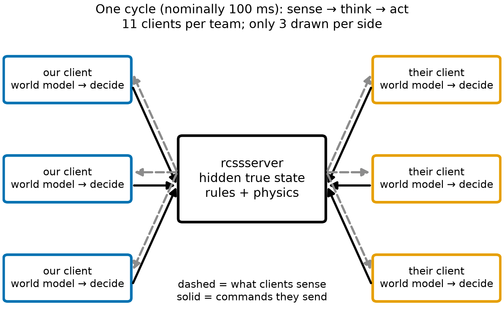
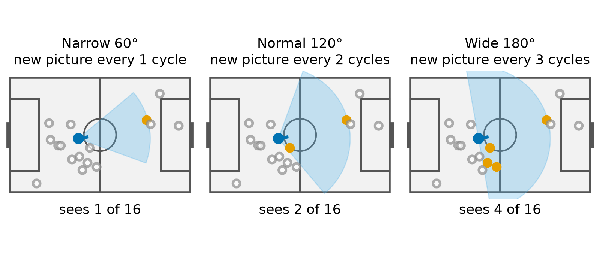
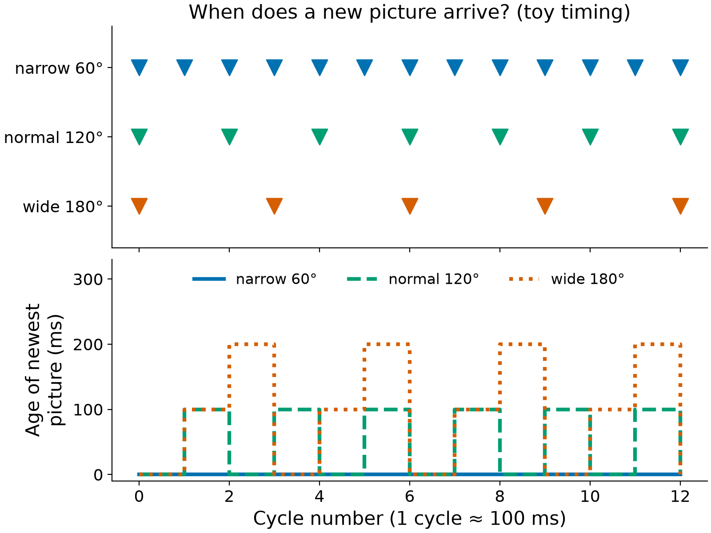
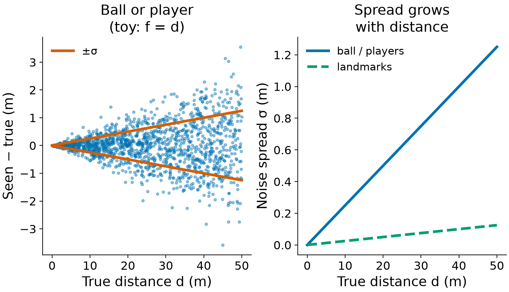
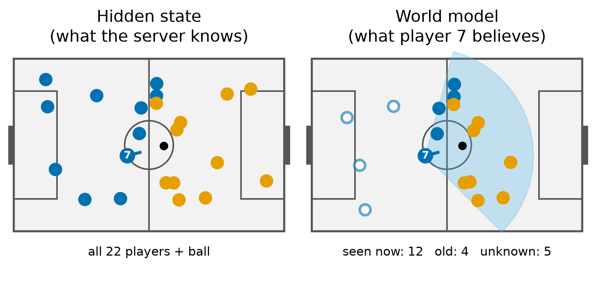

# Football in 100 Milliseconds

*Part 1: What the RoboCup 2D simulator is, and why every virtual player only sees part of the pitch*

> **About this series.** I am a high-school IB student. I build hardware projects, and I own a PYNQ-Z2 board. (That is an FPGA board: a board with a chip whose circuits you can reprogram.) In this series I explore the algorithms and math of football. I use the RoboCup Soccer Simulation 2D as my lab, and I ask how the ideas connect to real hardware.
>
> I used an AI assistant to help me draft the text and code. The ideas, the structure and the checking are mine.
>
> [[CHECKED: I checked these facts against the official manual: ... (author fills in)]]
>
> The Python demos are my own small toy models. They use equations from my sources, but they are not the official simulator. I did not run the official simulator (rcssserver) for this article.

[[AUTHOR: 2-3 real sentences about why I, a hardware student, care about this]]

## A strange way to play football

Imagine you play a match with your eyes almost closed. Up to 10 times every second, a voice whispers numbers to you: *"Ball: 23 metres, 15 degrees to your left. Teammate: 9 metres, straight ahead."*

Sometimes the numbers are a bit wrong. Sometimes nobody tells you about the player behind you. Then you have a short moment to decide: run, turn or kick.

Could you still play well?

This is close to the daily life of a player in the RoboCup 2D simulator. This part answers two questions:

- How can computer programs play football against each other?
- What does each player actually *know*?

The math is short: Pythagoras, angles, and a bell curve.

## The idea in plain words

RoboCup Soccer Simulation 2D is a football match inside a computer. It has two kinds of programs.

**The server.** A program called `rcssserver` runs the match. It moves the ball and the players and applies the rules. It also sends each player *limited* information about the world (Noda et al., 1998; RoboCup Soccer Simulator maintainers, n.d.).

**The clients.** Each player is a separate program, called a *client*. A client receives messages from the server and builds its own picture of the world. Then it decides what its own player should do next.

A full match has 22 of these independent agents (Noda and Stone, 2003). An *agent* is a program that senses and acts on its own.

Clients talk with the server over UDP. UDP is a simple way to send short messages between programs on a network (Noda et al., 1998). Each client has its own limited point of view. Only the server sees the whole pitch.

Why football? The original authors chose it to test two hard things at the same time: **cooperation**, and **reacting in real time when you are not sure what is happening** (Noda et al., 1998).

> The server knows the truth. Each player only has a guess.

### Two worlds: hidden state and world model

This is the most important idea of the whole series.

1. **Hidden state** is the true position and speed of everything on the pitch. Only the server has it.
2. **World model** is each player's own *belief* about the hidden state. The player builds it from incomplete messages with small errors.

The simulator manual describes both sides: the physics inside the server, and the limited messages that each player receives (RoboCup Soccer Simulator maintainers, n.d.). Every later algorithm in this series works on the world model, not on the truth. That includes interception, positioning, passing and learning.

*Figure 1. One cycle: the server sends what each player senses, each client thinks, and each client sends commands back.*

## Five ways to look at the same thing

**The player on the pitch:** "I only see part of the pitch. Sometimes I am not sure who is behind me."

**The coach:** "I can't shout long instructions. A player can send a short message with the `say` command. It has at most 10 characters, from a limited set of letters and symbols. By default it reaches only 50 m. Each team can hear only a limited number of messages, and when too many arrive, they compete for those places." (RoboCup Soccer Simulator maintainers, n.d., §§4.3.1 and 4.5.5)

**The mathematician:** "Each player sees only part of the truth. In math words, this is a *partially observed* system. The true state is a long list of numbers. Each player sees only a small, noisy piece of that list."

**The programmer:** "Nobody starts from zero. HELIOS Base includes a client library called librcsc. It handles communication and timing, geometry, a world model and basic actions. It also includes a sample team, agent2d, which organizes decisions in agent, role and behavior layers." (Akiyama and Nakashima, 2014)

**The hardware engineer:** "This is a system with a clock and a deadline. New input arrives, and the answer must be ready before the next tick. A faster chip can only speed up the thinking step. Sending and receiving messages takes time too." A later part of this series looks at this in detail.

## How to read the formulas

Each formula has a short tag:

- **[Sim v19]** = *Simulator rule, v19.0.0.* A rule of the simulator, as described in the manual or the version 19.0.0 code.
- **[Derived]** = *Derived here.* A result worked out in this article, with a proof.
- **[Toy]** = *Toy model.* My own simplification for teaching.

## The math, step by step

### Step 1: Time comes in ticks

The simulator does not run in smooth time. It runs in steps called **cycles**. One cycle is nominally 100 ms (RoboCup Soccer Simulator maintainers, n.d., §4.3). "Nominally" means this is the planned length.

$$
\frac{1000\ \mathrm{ms}}{100\ \mathrm{ms}} = 10\ \text{cycles per second}
$$

**[Derived]** So a player can act up to 10 times per second. Think of a flip-book: each page is one cycle, and the world jumps from page to page.

Each cycle, a *body sensor* also tells the player about itself: its estimated speed, its effort, its stamina, and how many commands it has sent (§4.8). Stamina is like your energy level in a real match. It comes back in Part 2.

### Step 2: How wide, and how often, a player sees

A player sees inside a **view cone**, like the beam of a torch. Since version 18, the default vision is called *synchronous*. The manual gives three widths (§4.3.2). **[Sim v19]**

- **narrow:** 60°, a new picture every 1 cycle
- **normal:** 120°, a new picture every 2 cycles
- **wide:** 180°, a new picture every 3 cycles

**Claim [Derived]:** On average, all three modes give the same view angle per cycle.

$$
\frac{60^\circ}{1} = \frac{120^\circ}{2} = \frac{180^\circ}{3} = 60^\circ\ \text{per cycle}
$$

**Proof:**

1. Narrow: 60° per 1 cycle = 60° per cycle.
2. Normal: 120° per 2 cycles = 60° per cycle.
3. Wide: 180° per 3 cycles = 60° per cycle. All three are equal. ∎

But be careful with this result. The three modes give the same angle per cycle only *on average*. A wide view shows more of the pitch at once, but each picture is older. A narrow view shows less of the pitch, but each picture is fresher. "Degrees per cycle" is a simple measure. It is not a full measure of information.

The gap between two pictures is 100, 200 or 300 ms. **[Derived]**

> The real choice: see more of the pitch at once, or see it more often.

One more detail. Objects very close to you but *outside* the cone can still be reported, but with limited identity (§4.3.2). It is like feeling someone right behind you without seeing their shirt number.

*Figure 2. The same player in the three view modes. Coloured dots are inside the cone. Hollow grey dots are not seen. Toy cone radius.*

In my toy timeline, the newest picture is at most 0, 100 or 200 ms old, for narrow, normal and wide. **[Toy]**

*Figure 3. When new pictures arrive (top) and how old the newest picture is (bottom). Toy timing.*

### Step 3: Seeing in distance and direction

The server does not send "x = 12, y = 5". It sends **how far** and **in which direction**, measured from where you are looking.

Let $r = (r_x, r_y)$ be the position of an object *relative to you*. The manual gives these two rules (§4.3.2). **[Sim v19]**

$$
d = \sqrt{r_x^2 + r_y^2}
$$

$$
\theta = \operatorname{atan2}(r_y, r_x) - (\phi_{\mathrm{body}} + \phi_{\mathrm{head}})
$$

In plain words:

- $d$ is the distance. It comes from Pythagoras.
- $\theta$ (the Greek letter theta) is the *bearing*: the direction of the object, compared with where you are looking.
- $\operatorname{atan2}(y, x)$ is a calculator function. It gives the angle of the arrow (x, y) and picks the correct quarter of the circle.
- $\phi_{\mathrm{body}}$ is the direction your body faces. $\phi_{\mathrm{head}}$ is how far your head is turned, compared with your body. Their sum is where you are looking.
- The angle is "wrapped": it is kept between −180° and 180°.

Your world model must turn this back into a position.

**Claim [Derived]:**

$$
r_x = d \cdot \cos(\theta + \phi_{\mathrm{body}} + \phi_{\mathrm{head}}), \quad r_y = d \cdot \sin(\theta + \phi_{\mathrm{body}} + \phi_{\mathrm{head}})
$$

**Proof:**

1. Add the body and head angles to both sides of the bearing rule. You get $\theta + \phi_{\mathrm{body}} + \phi_{\mathrm{head}} = \operatorname{atan2}(r_y, r_x)$, up to a full turn. A full turn does not change cos or sin.
2. atan2 gives the angle of the arrow r, measured from the x-axis.
3. Any arrow with length d and angle a has the parts $(d \cdot \cos a,\ d \cdot \sin a)$.
4. Put in our d and our angle, and you get the claim. ∎

My script tests this on 10,000 random examples. The largest error is about 1.0e-13 m. That is only computer rounding.

There is one catch. To use these formulas, the player must also know its *own* position and body angle. Those are estimates too, so small errors can add up.

### Step 4: Seeing with noise

In science, **noise** means small random errors. The messages from the server have noise. Version 19.0.0 has two noise models (RoboCup Soccer Simulator contributors, 2024).

**The default: rounded steps.** By default, distances are *quantized*. This means they are rounded to fixed steps, like a ruler that only shows whole centimetres. The rounding is done on the logarithm of the distance. My reading of the formula **[Derived]**: far objects get bigger rounding steps than close objects. My source does not give the step size, so I did not simulate this mode.

**The opt-in: Gaussian vision.** "Opt-in" means you must switch it on. Version 19.0.0 has a setting called `gaussian_see`. With it, the seen distance comes from a random draw on a bell curve (a *normal* or *Gaussian* distribution). **[Sim v19]**

$$
Z \sim \mathcal{N}(d, \sigma^2), \qquad \sigma = r_d \cdot d + r_f \cdot f
$$

$$
D = \max(0, Z)
$$

Here:

- $\sigma$ (sigma) measures how spread out the errors are.
- $f$ is the focus-to-object distance.
- $r_d$ and $r_f$ are two rates. In the default settings, both are 0.0125 for movable objects (the ball and players). For landmarks (fixed markers on the field) both are 0.00125.
- The max(0, Z) part makes sure the seen distance is never negative.

In my toy demo I assume that f equals d. **[Toy]** Then:

$$
\sigma = (r_d + r_f) \cdot d = 0.025 \cdot d
$$

For example:

- at 10 m, σ = 0.25 m
- at 40 m, σ = 1 m

Far things are blurrier. For landmarks the rates are 10 times smaller, so σ is only 0.025 m at 10 m and 0.1 m at 40 m.

My script draws 200,000 random samples at 40 m. The measured spread is 1.002 m. The formula says 1 m.

One warning from my source: one line of the manual suggests multiplying the random sample by d. The version 19.0.0 code does not do that, so my demo does not either.

*Figure 4. Toy Gaussian vision. Errors grow with distance. Landmarks are much less noisy than the ball and players.*

### A note on versions (said once in this series)

This series uses one exact version of the server: **rcssserver 19.0.0**, released on 25 March 2024. The manual is official, but it is "living documentation". It is not frozen to one release, and it is not always consistent.

For some values, the manual's tables differ from the version 19.0.0 code. Two examples: the code has `back_dash_rate = 0.7` and `effort_dec = 0.005`, and the manual's dash and stamina tables give different values. In this series I always use the version 19.0.0 values.

## Putting it together: truth versus belief

Figure 5 shows the big idea in one picture. On the left is the hidden state: all 22 players and the ball. On the right is what player 7 believes:

- solid dots for things it sees now (with small errors),
- hollow, faded dots for old memories,
- nothing at all for players it has lost track of.

*Figure 5. Left: what the server knows. Right: what player 7 believes. Toy model: memories, drift and exact bearings are my simplifications.*

The memories and drift on the right are my own toy, not rules of the simulator. But the shape of the problem is real: every decision is made on the right-hand picture.

## Common mistakes

- **"The client knows where everything is."** It doesn't. Only the server knows. Each client works with a partial belief that has errors.
- **"Wide view is always better."** Not always. A wide view shows more of the pitch at once, but the pictures are older. A narrow view shows less, but the pictures are fresher.
- **"Noise is the same everywhere."** In the Gaussian mode, the spread grows with distance.
- **"The client moves a robot."** A 2D client receives simulated observations and sends commands like `dash`, `turn` and `kick` (RoboCup Soccer Simulator maintainers, n.d.). There are no motors here.
- **"Every number in the manual is current."** Some tables disagree with the version 19.0.0 code. Always say which version you use.

## What we learned

- The server holds the **hidden state**. Each of the 22 clients builds its own **world model** from limited messages with errors.
- Time moves in **cycles** of nominally 100 ms. The view modes trade **width against freshness**, with the same $60^\circ$ per cycle on average.
- Players see **distance and bearing**, not x and y. With Gaussian vision, far objects are blurrier.

## Try it yourself

1. Run `build_part1.py`. Change `SEED` at the top and compare the new Figure 5.
2. Invent a new view mode: 240° every 4 cycles. How many degrees per cycle does it give? How old can the newest picture get? (The script prints the answer at the end.)
3. In the script, set `R_MOVABLE` to the landmark value (0.00125). How much sharper does Figure 4 become?
4. Explain to a friend, in two sentences, why a footballer might *prefer* a narrow view.

[[AUTHOR: link to your GitHub repository with the code]]

## Next time

When you stop pedalling a bike, it slowly rolls to a stop. A kicked ball in the simulator does something similar. In the version 19.0.0 code, when nothing else acts on it, the ball keeps 94% of its speed each cycle. In Part 2 the question is: **if I kick the ball at a certain speed, where will it stop?** The answer is a famous piece of school math: the geometric series.

## What I am not sure about

- My noise demo assumes that the focus distance f equals the distance d. My source defines f as the "focus-to-object distance" but does not explain when the two differ.
- My source does not give the step size of the default (rounded) noise, so I could not show how big the default errors are.
- I don't know exactly what "limited identity" looks like in a real message for close objects behind the player.

[[AUTHOR: add, remove or rewrite these doubts in your own words]]

## References

- Akiyama, H., and Nakashima, T. (2014). "HELIOS Base: An Open Source Package for the RoboCup Soccer 2D Simulation." In *RoboCup 2013: Robot World Cup XVII*, pp. 528–535. Springer. [add link after checking]
- Noda, I., Matsubara, H., Hiraki, K., and Frank, I. (1998). "Soccer Server: A Tool for Research on Multiagent Systems." *Applied Artificial Intelligence*, 12(2–3), 233–250. [add link after checking]
- Noda, I., and Stone, P. (2003). "The RoboCup Soccer Server and CMUnited Clients: Implemented Infrastructure for MAS Research." *Autonomous Agents and Multi-Agent Systems*, 7, 101–120. [add link after checking]
- RoboCup Soccer Simulator contributors. (2024). *rcssserver-19.0.0*. GitHub software release, published 25 March 2024. [add link after checking]
- RoboCup Soccer Simulator maintainers. (n.d., living documentation). "4. Soccer Server." In *The RoboCup Soccer Simulator Users Manual*. [add link after checking]
