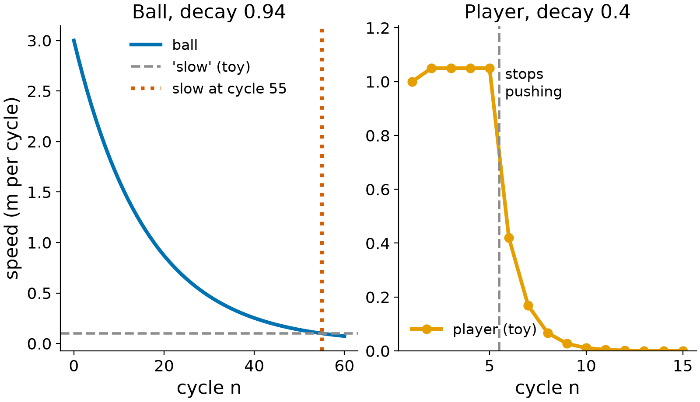
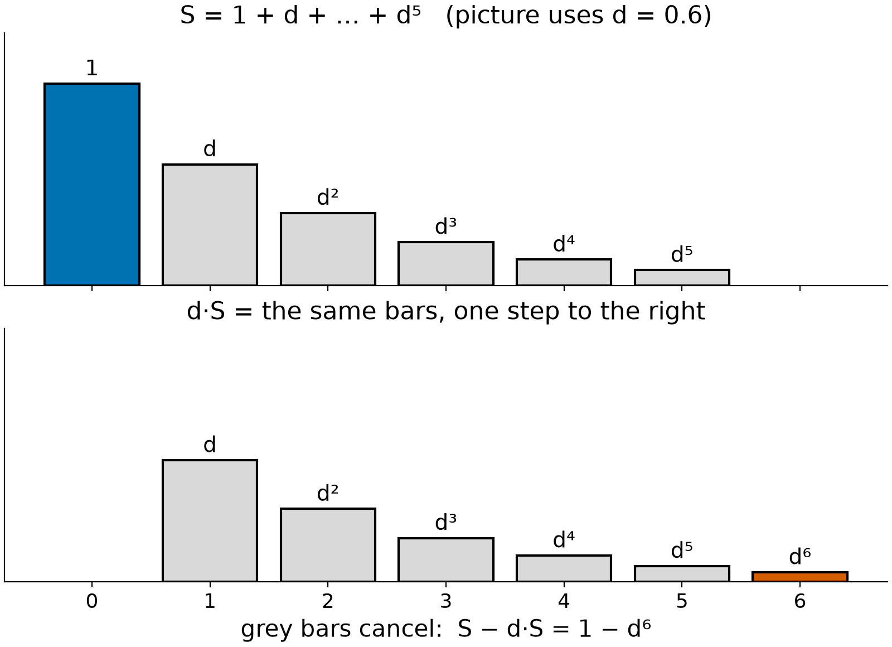
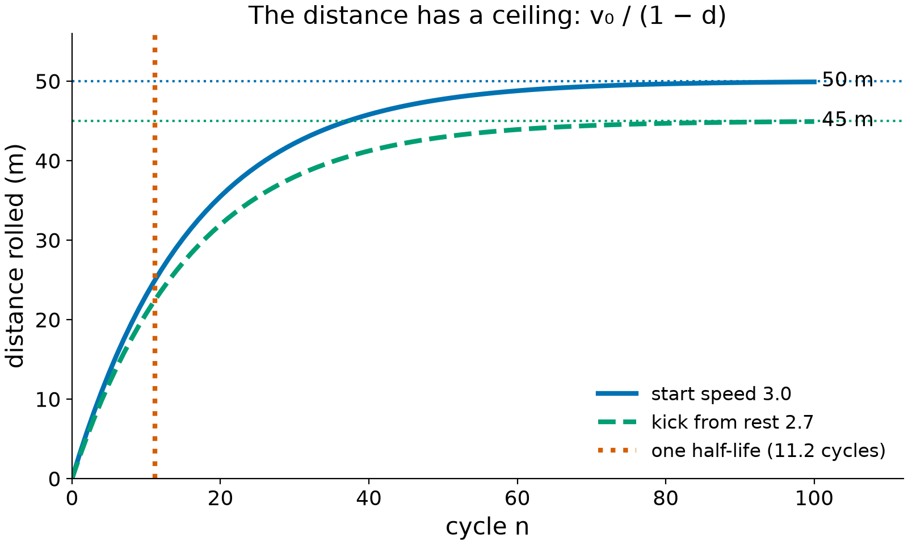
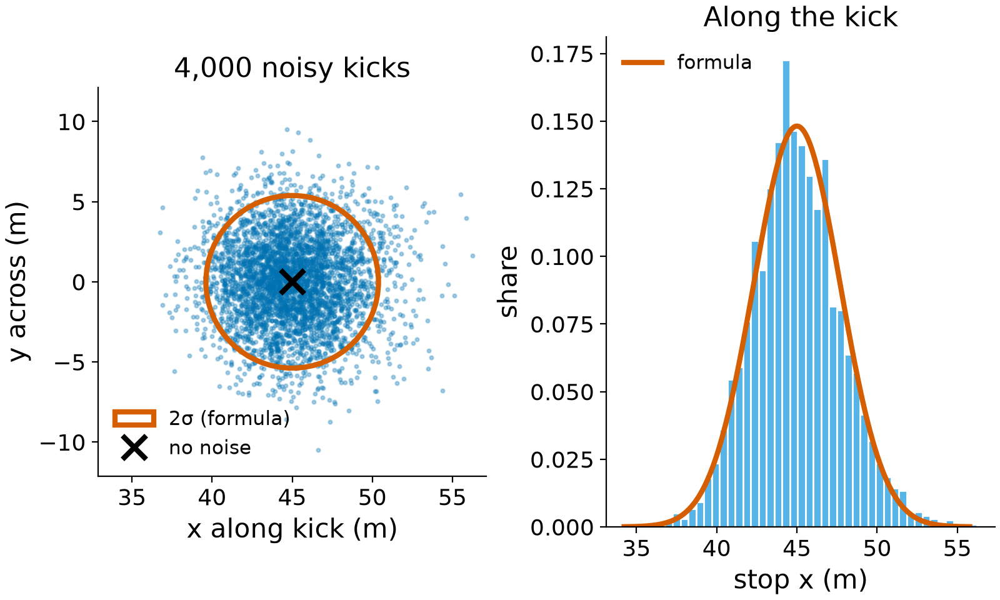
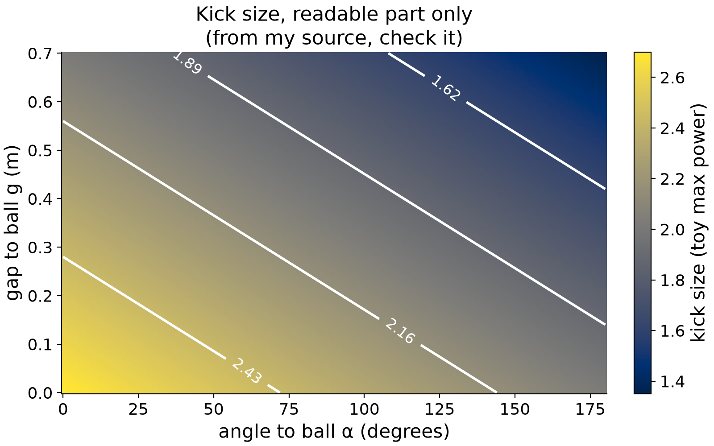

# Why the Ball Stops: Decay and the Geometric Series

*Part 2 of Football Math with RoboCup 2D: a rolling ball, a famous school formula, and why it matters for chips*

> **About this part.** I am a high-school IB student, and I build hardware projects on my PYNQ-Z2 FPGA board. I used an AI assistant to help me draft the text and code. The ideas, the structure and the final decisions are mine.
>
> The numbers in this article come from a literature report about the manual and the rcssserver 19.0.0 code. I have not yet compared each one with the original source.
>
> For this article I ran the build script and read the literature report. The Python demos are my own toy models. I did not run the official simulator (rcssserver). All code is here: https://github.com/ziydin/robocup2d-math-series

I love football, and I am trying to understand its theory and its basic logic. That is why I wanted to look deeply at the math of the game. I am also interested in hardware engineering. I want to build a bridge between the two fields, so that I can see the whole picture.

## The bike that does not stop at once

Stop pedalling on a flat road. Your bike does not stop at once. It rolls on and slows down little by little.

A kicked ball in the RoboCup 2D simulator does the same. Each cycle it keeps 94% of its speed and loses 6%. (A cycle is one step of the simulation, nominally 100 ms. See Part 1.)

So here is today's question: **if I kick the ball, where will it stop?**

My first guess was "it rolls forever", because it never loses *all* its speed. That guess is wrong, and the reason is one of the nicest ideas in school math: the **geometric series**.

*Version note: all values are for rcssserver 19.0.0 (25 March 2024). Some manual tables differ from this code, for example `back_dash_rate = 0.7` and `effort_dec = 0.005` in the code (details in Part 1).*

## The idea in plain words

The word **decay** here means "slowing down by the same fraction every cycle". The ball's decay is 0.94. The player's decay is 0.4.

Distances are in simulator units, which I call metres. Speeds are in metres per cycle. The ball's speed cap is 3.0 per cycle. At 10 cycles per second that is 30 m/s.

**My update rule [Toy].** For a rolling ball that nobody touches, I use this order in each cycle:

1. move: position = position + velocity,
2. slow down: velocity = decay × velocity.

My source describes the same order, but I have not checked it in the code. So I mark it as my assumption.

$$
x_{t+1} = x_t + v_t, \qquad v_{t+1} = d \cdot v_t
$$

## The math, step by step

### Step 1: the speed

Each cycle multiplies the speed by d. After n cycles we multiplied n times. **[Derived]**

$$
v_n = v_0 \cdot d^{n}
$$

The speed gets smaller and smaller, but it never becomes exactly zero.

*Figure 1. Speed per cycle. The ball keeps 94% each cycle, the player only 40%. Toy model.*

### Step 2: the distance, and the "multiply and subtract" trick

The ball moves v₀ in the first cycle, v₀·d in the second, v₀·d² in the third, and so on. So the distance after n cycles is v₀ times this sum:

$$
S = 1 + d + d^{2} + \dots + d^{n-1}
$$

Adding many terms is slow. Here is a trick to add them all at once. Multiply the whole sum by d:

$$
d \cdot S = d + d^{2} + \dots + d^{n-1} + d^{n}
$$

Now subtract the second line from the first. Almost every term appears in both lines, so they cancel. Only the first term of S and the last term of dS survive:

$$
S - d \cdot S = 1 - d^{n} \quad \Longrightarrow \quad S = \frac{1 - d^{n}}{1 - d}
$$

That is the whole proof. ∎ Multiply by v₀, and we get the **closed form**. A closed form is a formula that gives the answer directly, without a loop. **[Derived]**

$$
x_n = v_0 \cdot \frac{1 - d^{n}}{1 - d}
$$

My script compares this formula with a step-by-step loop in 662 cases. The largest difference is 7.8 × 10⁻¹⁴, which is just computer rounding.

*Figure 3. The multiply and subtract trick. Only the first bar of S and the last bar of d times S survive.*

### Step 3: the ceiling

When n gets very large, dⁿ gets close to zero. So the distance gets close to a fixed number. **[Derived]**

$$
x_{\infty} = \frac{v_0}{1 - d} = \frac{3.0}{0.06} = 50\ \mathrm{m}
$$

So with the top speed of 3.0 and decay 0.94, a ball can never roll more than **50 m** in my toy (no noise, no players in the way). When I first saw this, I did not believe it. So I made the script check it with a long loop.

One honest detail: one push from rest is limited by the acceleration cap of 2.7. A ball kicked from rest at that speed stops at 45 m. The 50 m case needs a ball that already moves at the top speed.

The same idea gives a handy rule. The distance still left to roll is always the current speed times 16.7: **[Derived]**

$$
x_{\infty} - x_n = \frac{v_n}{1 - d} \approx 16.7 \cdot v_n
$$

*Figure 2. The distance grows but never passes v0 / (1 − d), which is 50 m at top speed. Toy model, no noise.*

### Step 4: when is the ball "slow"? Logarithms

Let me call a ball "slow" when its speed is below 0.1 per cycle (my own choice). We need v₀·dⁿ < s. Take the logarithm of both sides. A logarithm turns "power" into "times", so we can get n down from the top. Careful: ln d is negative, so the inequality sign flips. **[Derived]**

$$
v_0 \cdot d^{n} < s \iff n > \frac{\ln(s / v_0)}{\ln d}
$$

For a ball at 3.0, the right side is 54.97, so the ball is slow from cycle **55** (about 5.5 s). By then it has already rolled 48.3 m, which is 96.7% of the ceiling.

A nice way to feel this is the **half-life**: how many cycles until the speed is halved. **[Derived]**

$$
d^{h} = \frac{1}{2} \iff h = \frac{\ln 2}{-\ln d}
$$

For the ball, h ≈ 11.2 cycles (about 1.12 s). After one half-life the ball has covered 50% of its total distance. After two half-lives, 75%. For a player, h ≈ 0.76 cycles: less than one cycle!

### Step 5: the inverse problem

Now turn the question around. A teammate stands D metres away. What kick speed do I need?

**To stop exactly at D**, use the ceiling formula backwards. **[Derived]**

$$
v_0 = D \cdot (1 - d)
$$

For D = 20 m: v₀ = 1.2.

**To arrive at D after exactly n cycles**, solve the closed form for v₀. **[Derived]**

$$
v_0 = \frac{D \cdot (1 - d)}{1 - d^{n}}
$$

For D = 20 m and n = 10: v₀ = 2.60. The ball is still moving at 1.40 when it arrives, so the teammate must control it.

**What is the fastest possible arrival?** Use the biggest kick from rest, 2.7, and solve for n. **[Derived]**

$$
n_{\min} = \left\lceil \frac{\ln(1 - D(1 - d) / a_{\max})}{\ln d} \right\rceil
$$

For 20 m the right side is 9.50, so the fastest arrival is **10 cycles**. Arriving in 9 cycles would need 2.81, which is above the cap. And 5 cycles would need 4.51: impossible. In 5 cycles, even the biggest kick only covers 12.0 m.

### Step 6: why players stop almost at once

A player has decay 0.4. It keeps only 40% of its speed each cycle. In my toy the player pushes with the full acceleration 1.0 every cycle. Then the speed cap 1.05 applies. **[Toy]**

$$
u_t = \min(v_t + a,\ v_{\max}), \qquad x_{t+1} = x_t + u_t, \qquad v_{t+1} = d_p \cdot u_t
$$

- Cycle 1: speed 1.
- Cycle 2: already at the cap, 1.05.

Without the cap, the speed would settle where "push in" equals "decay out", at 1.67. That is the same geometric sum again: 1 + d + d² + ... = 1/(1 − d) = 1.67. So the cap really matters.

When the player stops pushing, the first move is 0.42, and the total coasting distance is only **0.7 m**. A ball with the same rule and the same top speed would coast 16.4 m, about 24 times more. Players are like shopping trolleys on carpet. The ball is like a trolley on ice.

## Four ways to look at it

**The player:** "I stop almost at once, so I can change direction quickly. The ball doesn't. I must plan where it will be."

**The mathematician:** "Every question today was the same geometric series: speed, distance, ceiling, player top speed."

**The programmer:** "A closed form replaces a loop. I can ask 'where after 30 cycles?' with one line instead of 30 steps."

**The hardware engineer:** "Each cycle is one multiply and one add. That is a classic small circuit." (More at the end.)

## Noise: the ball wobbles

The simulator adds a small random push to the velocity every cycle. In the v19 code the push has a random direction and a random size, from zero up to r × speed. For the ball r = 0.05, so up to 5% of the speed. For a player r = 0.1. **[Sim v19]**

$$
\tilde{v} = \bar{v} + R \cdot (\cos\Theta, \sin\Theta), \quad R \sim U[0,\ r \lVert \bar{v} \rVert], \quad \Theta \sim U[-\pi, \pi]
$$

Note: the *size* is uniform, not the *area*. Small pushes are more common than in a uniform disc.

I kicked the ball 4,000 times in my toy, each time at 2.7 along the x-axis, and let it roll 300 cycles. Without noise it stops at 45.00 m. With noise, the average stop is at x = 45.00 m, y = -0.00 m. The spread is 2.77 m along the kick and 2.71 m across it.

**Can we predict the spread? [Derived, approximate]**

1. Each push has average zero, so the average stop does not move.
2. A push δ in one cycle changes every later move: δ + dδ + d²δ + ... = δ/(1 − d). The geometric series again!
3. One push of size up to r·s, with a uniform size, has an average squared size of (r·s)²/3. Half of that goes into each direction.
4. Independent random pushes add up through their *squares*. The speeds are v₀·dᵏ, so the squares give 1 + d² + d⁴ + ... = 1/(1 − d²).
5. Take the square root:

$$
\sigma_{\mathrm{stop}} \approx \frac{r \cdot v_0}{(1 - d)\sqrt{6\,(1 - d^{2})}}
$$

The formula gives 2.69 m. It is approximate, because the speeds themselves are a bit noisy. The Monte Carlo test agrees within a few percent. (Monte Carlo means "try many random cases and look at the results".)

*Figure 4. Stopping points of 4,000 noisy kicks in my toy. The red curves come from the spread formula.*

## The kick: only the part I can read

My source gives the kick formula, but part of it is garbled. I can read the *size* of the kick acceleration. I cannot read the *direction* part, so I leave it out. This is from my source; please check it in the manual. **[Sim v19, from my source]**

$$
\lVert a_{\mathrm{kick}} \rVert = P \cdot k_{\mathrm{kick}} \cdot \left(1 - 0.25\,\frac{\alpha}{\pi} - 0.25\,\frac{g}{m}\right)
$$

- P is the kick power.
- k_kick = 0.027.
- α (alpha) is the angle between where the body faces and where the ball is, from 0 to π.
- g is the gap between the player and the ball. m = 0.7 m is the kickable margin: how far the ball can be and still be kicked.

So a ball straight ahead and touching gets the full kick. A ball behind you and at the edge of reach gets only 50%. With my toy maximum power P = 100 (not from my source), the kick ranges from 2.7 down to 1.35.

*Figure 5. Readable part of the kick formula. The maximum power is my toy value. The kick direction is left out on purpose.*

**Stamina, in one paragraph.** Running costs energy, called stamina. When stamina gets low, the player's *effort* can drop, and pushes get weaker. In the v19 code, effort drops by 0.005 at a time. My toy player has endless energy, so this part ignores stamina.

## Common mistakes

- **"It never stops, so it rolls forever."** The speed never reaches zero, but the *distance* has a ceiling.
- **"Every kick can reach 50 m."** From rest, one kick only reaches 45 m in my toy.
- **"Off by one cycle."** Check your indexing: is v₀ the speed before or after the first decay?
- **"Players move like the ball."** Decay 0.4 versus 0.94 is a huge difference.
- **"Noise averages out, so ignore it."** The average stays, but the stopping points spread out.

## What we learned

- Speed after n cycles is v₀·dⁿ. Distance is a geometric series with the closed form v₀(1 − dⁿ)/(1 − d).
- The ceiling v₀/(1 − d) gives 50 m for the ball and only 0.7 m of coasting for a player.
- Logarithms answer "how many cycles?", and the same series predicts how noise spreads the stopping point.

## Try it yourself

1. What kick speed stops the ball at exactly 30 m?
2. A ball rolls at 2. From which cycle is it slower than 0.1?
3. If the ball decay were 0.95, what would the ceiling be at top speed?
4. If the player decay were 0.6, how far would a player coast from top speed?

The script prints all four answers at the end. Code: https://github.com/ziydin/robocup2d-math-series

## Hardware teaser (a HYPOTHESIS, not a measurement)

Each cycle the ball does "position += velocity; velocity ×= decay". On a chip, this is a **multiply-accumulate** loop. Many FPGA designs use **fixed-point** numbers: an integer that counts small steps.

In 16-bit fixed point with 15 fraction bits (format Q1.15), the decay is stored as the integer 30802:

$$
0.94 \approx \frac{30802}{2^{15}} = 0.940002441
$$

The error is 2.4 × 10⁻⁶. Tiny? It moves the 50 m ceiling to 50.0020 m, only 2.0 mm. But rounding *during* the loop matters more. I stored the speed with 12 fraction bits (steps of 0.244 mm), so the kick 2.7 becomes 11,059 steps:

- **Round down** after each multiply: the ball stops after 114 cycles at 44.766 m, 23.4 cm short of the exact 45 m.
- **Round to nearest**: the speed gets stuck at 8 steps and never reaches zero! The ball creeps 1.95 mm per cycle: 46.71 m after 1,000 cycles, 48.66 m after 2,000.

The position also needs more than 16 bits, so my toy uses a 32-bit register. My hypothesis: on my PYNQ-Z2, this loop could run in a very small circuit, but the rounding mode must be chosen on purpose. I have not built or measured this yet.

## Next time

Now we know where the ball will be at every cycle. In **Part 3: "Can I Reach the Ball, and When?"** we race a player against the ball and look for the first cycle where the player wins.

## What I am not sure about

- The update order (move first, then decay) is my assumption. If the real code is different, my answers may be off by one cycle.
- My player pushes with full acceleration every cycle. I ignore dash power, turning, the kickable margin in movement, and stamina.
- I left out the kick direction, and the maximum kick power 100 is my own toy value.
- My spread formula is approximate. My toy has no collisions, no wind and no other players.

## References

- RoboCup Soccer Simulator contributors. (2024). *rcssserver-19.0.0*. GitHub software release, published 25 March 2024. https://github.com/rcsoccersim/rcssserver
- RoboCup Soccer Simulator maintainers. (n.d., living documentation). "4. Soccer Server." In *The RoboCup Soccer Simulator Users Manual*. https://rcsoccersim.github.io/manual/
